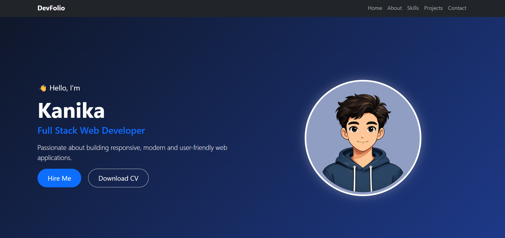
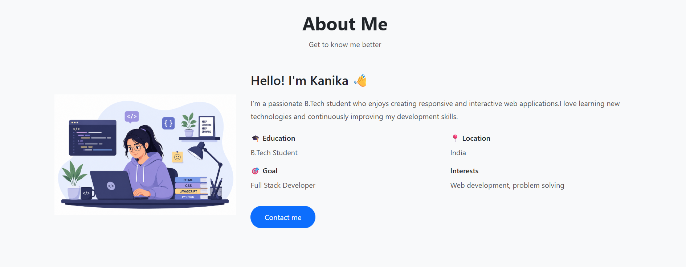
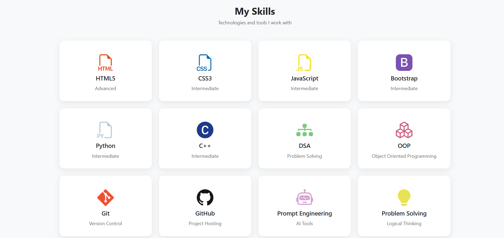
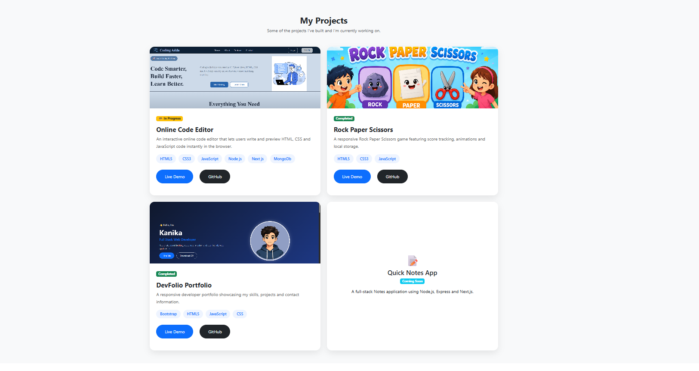
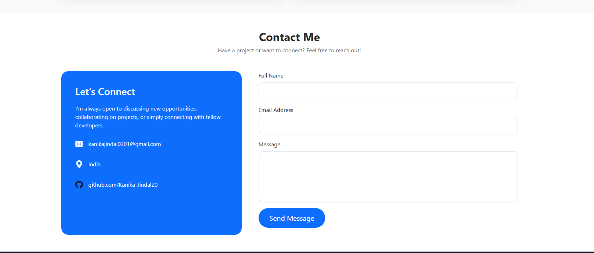

# 🌐 DevFolio - Personal Portfolio Website

A modern, responsive personal portfolio website built using **HTML, CSS, Bootstrap, and JavaScript**. It showcases my skills, projects, and contact information in a clean and user-friendly interface.

## 🚀 Live Demo

🔗 https://github.com/Kanika-Jindal20/DevFolio.git


---

## 📸 Screenshots

### 🏠 Home Page


### 👤 About Me


### 💻 Skills


### 🚀 Projects


### 📞 Contact


---

## ✨ Features

- 📱 Fully Responsive Design
- 🎨 Modern User Interface
- 👤 Hero Section
- 📖 About Me Section
- 💻 Skills Section
- 🚀 Projects Showcase
- 📧 Contact Form
- ✅ JavaScript Form Validation
- 🔗 Social Media Links
- 📍 Smooth Scrolling
- 🦶 Responsive Footer

---

## 🛠️ Built With

- HTML5
- CSS3
- Bootstrap 5
- JavaScript (ES6)
- Bootstrap Icons
- Devicon

---

## 📂 Project Structure

```text
DevFolio/
│
├── index.html
├── style.css
├── script.js
│
├── images/
│   ├── profile.png
│   ├── about.png
│   ├── code-editor.png
│   ├── rps.png
│   └── portfolio.png
│
└── README.md
```

---

## 🚀 Projects Included

### 💻 Online Code Editor *(In Progress)*
An interactive online code editor that allows users to write and preview HTML, CSS, and JavaScript code in real time.

Tech Stack: HTML5, CSS3, JavaScript, Node js, Next js, MongoDb

---

### ✊ Rock Paper Scissors

A responsive Rock Paper Scissors game with score tracking, local storage, and an interactive user interface.

Tech Stack: HTML5, CSS3, JavaScript

---

### 🌐 DevFolio

A responsive developer portfolio showcasing my skills, projects, and contact information.

**Tech Stack:** HTML5, CSS3, Bootstrap, JavaScript

---

### 📝 Quick Notes App *(Coming Soon)*

A full-stack notes application using Node.js, Express.js, and Next.js.

---

## 📥 Installation

Clone the repository:

```bash
git clone https://github.com/Kanika-Jindal20/DevFolio.git
```

Go to the project folder:

```bash
cd DevFolio
```

Open `index.html` in your browser.

---

## 🎯 Future Improvements

- 🌙 Dark Mode
- ✨ More Animations
- 📧 Backend Contact Form
- 🌐 Multi-language Support
- 📈 More Projects
- ⚡ Performance Optimization

---

## 📬 Contact

📧 Email: kanikajindal0201@gmail.com

🐙 GitHub: https://github.com/Kanika-Jindal20

💼 LinkedIn: https://www.linkedin.com/in/kanika-jindal-0b4a39303/

---

## 📄 License

This project is open-source and available under the **MIT License**.

---

## 👨‍💻 Author

**Kanika**

B.Tech Student | Aspiring Full Stack Developer

*"Building modern web applications, one project at a time."*